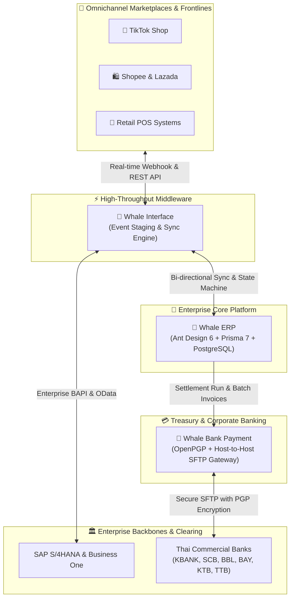

# 『 🐳 𝕎𝕙𝕒𝕝𝕖 𝕊𝕥𝕠𝕣𝕪 📖✨ 』
### Next-Generation Modern Enterprise Platform, Omnichannel Middleware & Banking Engine

  
  
  
  
  
  

  <em>"Every Enterprise Has a Story — We Build the Engine That Powers It."</em> 
  <strong>Whale Story</strong> transforms modern corporate workflows into seamless digital journeys, 
  unifying <strong>Cloud ERP</strong>, <strong>Omnichannel Middleware</strong>, and <strong>Multi-Bank Payment Gateways</strong> under a single elegant ecosystem.

---

## 🌌 สถาปัตยกรรมระบบนิเวศ (Whale Story Ecosystem Architecture)

---

## 🏛️ ผลิตภัณฑ์หลักในระบบนิเวศ (Flagship Solutions Catalog)

### 1. 🏢 [Whale ERP](https://github.com/Whale-Story/whale_erp) — Core Enterprise Business Platform
> ระบบบริหารทรัพยากรองค์กรยุคใหม่ พัฒนาบน **Next.js 16 (React 19)**, **Ant Design 6**, **Prisma 7 ORM**, **PostgreSQL** และ **NextAuth v5**

- **Enterprise Dashboard & Analytics:** สรุปยอดขาย สต็อก และสถานะการเงินแบบ Real-time
- **Master Data & Multi-Company:** รองรับโครงสร้างหลายบริษัท หลายสาขา และ Multi-Currency
- **Sales & Distribution:** จัดการคำสั่งซื้อ (Sales Order), ใบแจ้งหนี้, และสถานะการส่งมอบ
- **Inventory Management:** ตรวจสอบ Lot/Serial, จุดสั่งซื้อซ้ำ, และการโอนย้ายสินทรัพย์
- **Financial Accounting:** บันทึกผังบัญชี (Chart of Accounts), ลูกหนี้/เจ้าหนี้ และ Statement

---

### 2. ⚡ [Whale Interface](https://github.com/Whale-Story/whale_interface) — Omnichannel ERP Middleware
> ตัวกลางเชื่อมต่อข้อมูลอัตโนมัติประสิทธิภาพสูงระหว่าง E-Commerce ชั้นนำ, POS และระบบ ERP หลัก

- **Direct API Connector:** เชื่อมโยง TikTok Shop, Shopee, Lazada และ Retail POS ครบวงจร
- **Zero Monthly Quotas:** อิสระจากการคิดค่าบริการตามจำนวน Transaction ต่อเดือน
- **Data Transformation Engine:** แปลงโครงสร้าง Payload และจับคู่ Field อัตโนมัติด้วย Custom Logic
- **Audit Logs & Recovery:** ตรวจสอบย้อนหลังทุก Transaction และสั่ง Reprocess รายการที่ผิดพลาดได้ทันที

---

### 3. 💳 [Whale Bank Payment](https://github.com/Whale-Story/whale_bank_payment) — Multi-Bank Clearing Gateway
> ประตูเชื่อมต่อระบบจ่ายเงินองค์กรแบบอัตโนมัติ (Direct Credit / Payroll / Supplier Transfers) เข้าสู่ธนาคารพาณิชย์

- **Bank Format Generator:** สร้างไฟล์ตามมาตรฐานเฉพาะของธนาคารไทย (K-Cash Connect, BBL iCash, SCB Anywhere ฯลฯ)
- **Host-to-Host SFTP Automated Delivery:** ส่งไฟล์เข้าระบบธนาคารโดยตรงผ่าน SFTP แบบไม่ผ่านมือคน
- **Bank-Grade Security:** เข้ารหัสความปลอดภัยระดับธนาคารด้วย **OpenPGP** และ Signature Verification
- **Reconciliation & Status Feedback:** อ่านผลการตัดยอด (Bank Statement / Return File) กลับเข้าสู่ระบบ ERP

---

## 🛠️ จุดเด่นด้านเทคโนโลยี (Modern Technology Highlights)

| เทคโนโลยี | เวอร์ชัน | บทบาทหน้าที่ |
|---|:---:|---|
| **Next.js (Turbopack)** | `16.4+` | Fullstack SSR & High-throughput Edge Runtime |
| **React** | `19.3+` | Next-gen Concurrent UI Component Architecture |
| **Ant Design** | `6.4+` | Enterprise UI Design System & Component Library |
| **Prisma ORM** | `7.10+` | Type-Safe Database Modeling & Connection Pooling |
| **PostgreSQL** | `16+` | Relational Storage สำหรับ Transaction ปริมาณมหาศาล |
| **OpenPGP & SSH2** | `Latest` | การเข้ารหัสและช่องทางเชื่อมต่อ Host-to-Host SFTP ที่ปลอดภัย |

---

## 🤝 ร่วมสร้างสรรค์เรื่องราวไปกับเรา (Join Whale Story)

องค์กร **Whale Story** มุ่งมั่นพัฒนาซอฟต์แวร์ระดับองค์กรที่ทั้งทรงพลัง ยืดหยุ่น และใช้งานง่ายอย่างแท้จริง

- 🌐 **GitHub Organization:** [https://github.com/Whale-Story](https://github.com/Whale-Story)
- 📬 **Repositories:**
  - 🏢 [`whale_erp`](https://github.com/Whale-Story/whale_erp)
  - ⚡ [`whale_interface`](https://github.com/Whale-Story/whale_interface)
  - 💳 [`whale_bank_payment`](https://github.com/Whale-Story/whale_bank_payment)

   
  Crafted with ❤️ and Innovation by <strong>Whale Story Team</strong>. All rights reserved.

